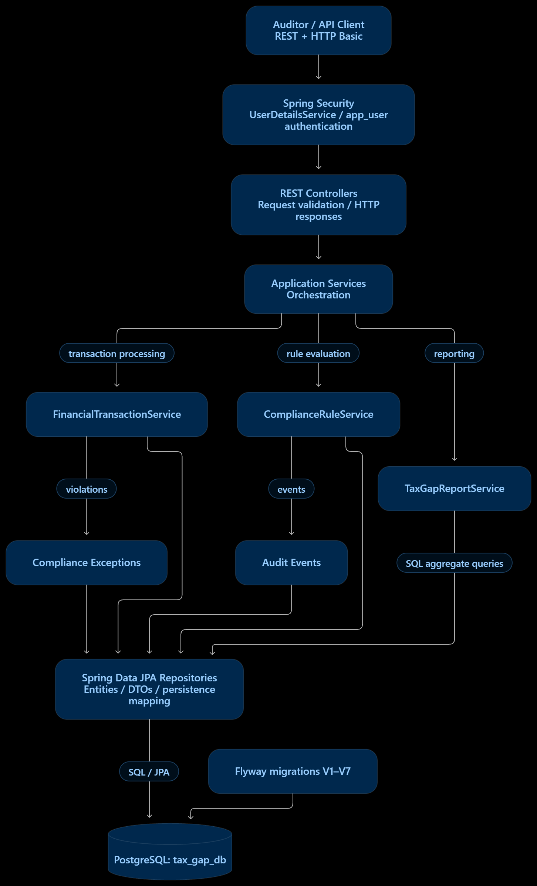

# Architecture — Tax Gap Detection & Compliance Validation Service

## Overview

The service uses a layered Spring Boot architecture. Controllers implement the HTTP contract and perform request-shape checks. Services own transaction ingestion, validation, tax computation, configurable compliance-rule execution, audit recording, and report orchestration. Spring Data repositories isolate PostgreSQL persistence. Flyway owns schema evolution; Hibernate schema generation is disabled (`ddl-auto=none`) to keep database changes versioned and repeatable.

## High-level architecture

## Batch transaction flow

1. The controller accepts a JSON array as `JsonNode` records rather than binding directly to a strict DTO. This allows one malformed/incomplete transaction to be recorded as a failed row without rejecting otherwise valid records in the batch.
2. The service preserves each raw record in `financial_transaction.raw_transaction` (`JSONB`) and validates required identifiers, ISO date, positive amount, non-negative numeric tax values, and transaction type.
3. Each record is persisted with `validation_status` `SUCCESS` or `FAILURE`; failures retain a JSON array of reasons. Invalid field values that violate database checks are not copied into typed columns, while the raw payload remains intact.
4. Valid records compute `expected_tax = amount × tax_rate`, rounded to two decimal places with `HALF_UP`. If reported tax is absent, the record is `NON_COMPLIANT`; otherwise `tax_gap = expected_tax − reported_tax`. A gap in [-1.00, 1.00] is `COMPLIANT`, greater than 1.00 is `UNDERPAID`, and less than -1.00 is `OVERPAID`.
5. Every ingested record gets an `INGESTION` audit event. Valid records get a `TAX_COMPUTATION` event. All enabled database rules are considered and a `RULE_EXECUTION` event records how many rules ran and exceptions were generated.

## Rule engine

`compliance_rule` stores a stable rule name/type, enabled flag, severity, and JSONB configuration. The rule service reads enabled rules for each record. The seeded rule types are:

- **`HIGH_VALUE`**: create an exception when amount exceeds the configured threshold.
- **`REFUND_LIMIT`**: for refunds, require `originalTransactionId` to resolve to a previously stored successful sale for the same customer; refund amount must not exceed that sale's amount.
- **`GST_SLAB`**: select the highest configured threshold not greater than the transaction amount and create an exception if the supplied rate is below the configured minimum rate.

The seeded slab values are examples for demonstrating configuration. They are not legal/tax advice. Rule enablement and JSON configuration can be changed through authenticated API endpoints without a new application build. Rule management requires the `ADMIN` role.

## Persistence model

PostgreSQL (`tax_gap_db`) is the source of truth. Flyway migrations V1–V7 create and evolve the schema; Hibernate schema generation is disabled (`ddl-auto=none`).

- `financial_transaction` stores typed transaction columns, raw JSONB, validation state, failure reasons, expected tax, tax gap, compliance status, and creation timestamp.
- `compliance_exception` is an append-oriented exception ledger.
- `audit_event` records transaction-level processing steps and JSONB detail.
- `compliance_rule` stores dynamic policy configuration.
- `app_user` supplies database-backed HTTP Basic identities and roles.
- `taxpayer`, `reported_income`, and `tax_gap_analysis` support the pre-existing taxpayer-level analysis APIs.
- `idempotency_record` stores idempotency keys, request fingerprints, and response details for idempotent requests.
- `flyway_schema_history` is Flyway's migration metadata table, not a business entity.

The inspected schema has database-enforced foreign keys from `reported_income.taxpayer_id` to `taxpayer.id`, and from `tax_gap_analysis.taxpayer_id` to `taxpayer.id`. `audit_event.transaction_id` and `compliance_exception.transaction_id` are logical transaction references; the database does not enforce foreign keys for them.

Customer tax summary is computed in a native SQL aggregate rather than loading all rows into application memory. Exception summary uses SQL grouping by severity and customer. Indexes cover common customer/status/date and exception filters.

## Security and operational behavior

All `/api/**` routes require HTTP Basic authentication against `app_user` through Spring Security's `UserDetailsService`. Rule management additionally requires the `ADMIN` role. The development administrator is inserted by Flyway and uses a BCrypt password hash; change it and the database credentials before deployment. Health/info actuator endpoints are public. CSRF is ignored for API routes because this API uses Basic authentication rather than browser cookie-based sessions; production deployments should use TLS and a deliberate API security policy.

The global exception handler returns stable API error shapes and logs unexpected server exceptions with their stack traces. Database constraint conflicts return HTTP 409; request-shape/validation errors return HTTP 400; missing resources return HTTP 404.

## Testing strategy

- Unit tests cover validation, tax computation/classification, rule behavior, and service logic.
- Service and rule-engine coverage is measured with JaCoCo; the assignment target is at least 40–50% coverage for these areas.
- MVC tests exercise response payloads/status codes, validation, filtering, and authentication.
- PostgreSQL-backed tests verify migrations, repository behavior, constraints, and aggregate reports where configured.
- From the project root, run `mvnw.cmd clean test` and `mvnw.cmd verify`, then inspect `target/site/jacoco/index.html` and capture the coverage report screenshot.

## Known production extensions

For large-volume workloads, add chunked/bounded ingestion, asynchronous processing, explicit batch idempotency guarantees, pagination for transaction/exception/audit listing, metrics and alerting, audit retention, and role-specific authorization for rule changes. The assessment implementation prioritizes clear correctness and testability with PostgreSQL-backed persistence.
